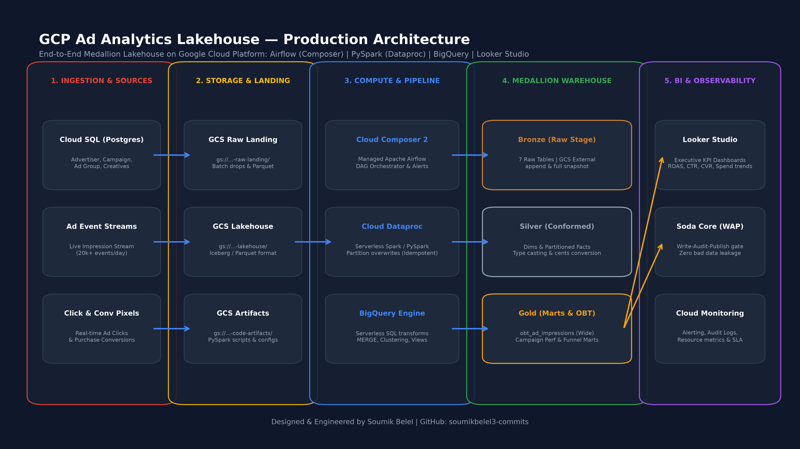
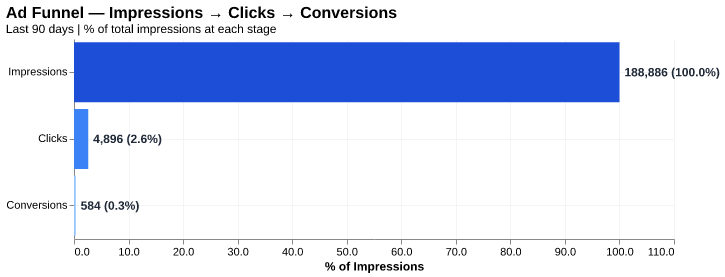
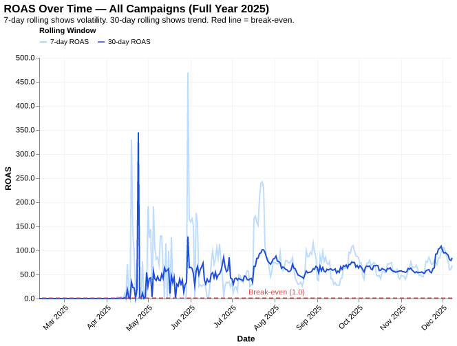
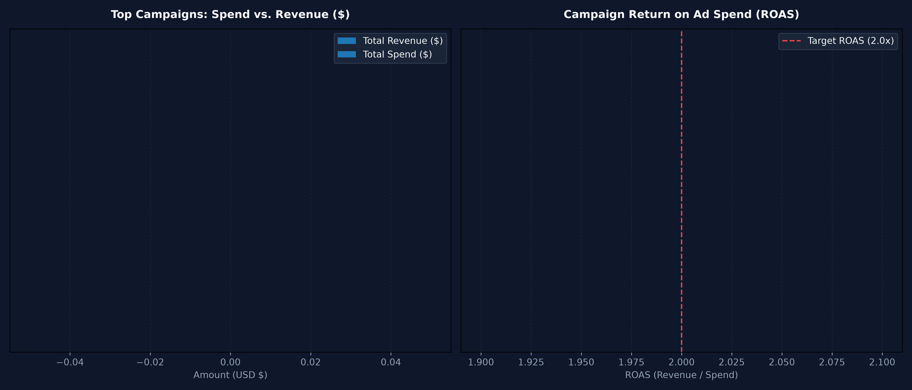
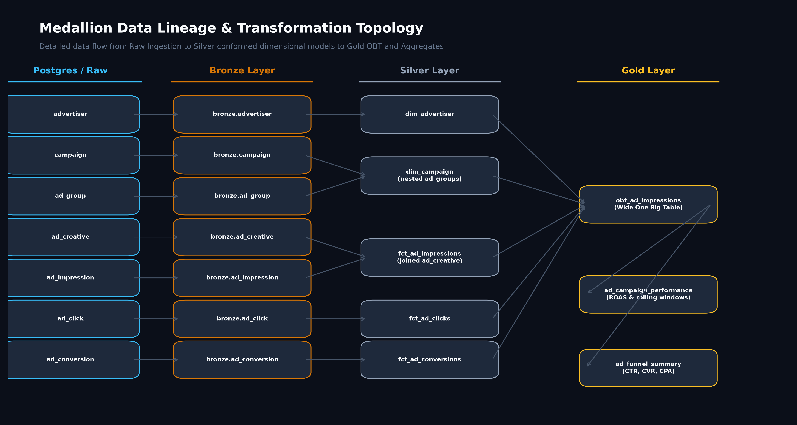

# GCP Ad Analytics Lakehouse — Production Medallion Platform

[](https://github.com/soumikbelel3-commits/gcp-ad-analytics-lakehouse/actions/workflows/ci.yml)


-017CEE?style=for-the-badge&logo=Apache%20Airflow&logoColor=white)
-E25A1C?style=for-the-badge&logo=apachespark&logoColor=white)


-000000?style=for-the-badge&logo=soda&logoColor=white)

An enterprise-grade, end-to-end **Advertising & Marketing Data Lakehouse** engineered natively on **Google Cloud Platform (GCP)**. Ingests high-velocity ad event streams (impressions, clicks, conversions) and operational dimensions, processes them through a **Bronze → Silver → Gold Medallion architecture** via **BigQuery & Dataproc (Serverless Spark)**, guarantees zero data corruption using the **Write-Audit-Publish (WAP)** pattern with **Soda Core**, and delivers business intelligence to **Looker Studio**.

---

## System Architecture

```mermaid
flowchart LR
    subgraph SRC["1. Ingestion Sources"]
        p1["Cloud SQL / Postgres (Advertiser, Campaign, Ad Groups, Creatives)"]
        p2["Ad Impression Stream (20k+ daily events)"]
        p3["Click & Purchase Conversion Pixels"]
    end

    subgraph GCS["2. Google Cloud Storage"]
        g1["gs://...-raw-landing/ (Event drops & Parquet)"]
        g2["gs://...-lakehouse/ (Iceberg / Delta Parquet)"]
    end

    subgraph ORCH["3. Orchestration & Compute"]
        a1["Cloud Composer 2 (Airflow DAG)"]
        a2["Cloud Dataproc (Serverless PySpark)"]
        a3["BigQuery SQL Engine (MERGE & Partition Overwrite)"]
    end

    subgraph BQ["4. BigQuery Medallion Layers"]
        subgraph BR["Bronze Layer"]
            b1["ad_analytics_bronze (7 Raw Tables)"]
        end
        subgraph SL["Silver Layer"]
            s1["dim_advertiser"]
            s2["dim_campaign (nested ad_groups)"]
            s3["fct_ad_impressions"]
            s4["fct_ad_clicks"]
            s5["fct_ad_conversions"]
        end
        subgraph GD["Gold Layer"]
            g_obt["obt_ad_impressions (Wide OBT)"]
            g_perf["ad_campaign_performance (ROAS)"]
            g_funnel["ad_funnel_summary (Funnel & CPA)"]
        end
    end

    subgraph BI["5. Quality & Analytics"]
        q1["Soda Core (Write-Audit-Publish Contract)"]
        v1["Looker Studio Executive Dashboard"]
    end

    SRC --> GCS
    GCS --> a1
    a1 --> a2 & a3
    a2 & a3 --> BR --> SL --> GD
    GD --> q1 --> v1

    classDef gcp fill:#4285F4,stroke:#1a73e8,color:#fff
    classDef bronze fill:#CD7F32,stroke:#8B4513,color:#fff
    classDef silver fill:#94A3B8,stroke:#64748B,color:#1e293b
    classDef gold fill:#F59E0B,stroke:#D97706,color:#000
    class BR bronze
    class SL silver
    class GD gold
```





---

## Stakeholders, Business Questions & Core KPIs

Marketing stakeholders require aggregated, real-time attribution intelligence to optimize millions in ad spend across campaigns and channels. Direct queries against transactional databases (PostgreSQL / Cloud SQL) cause query timeouts, lock contention, and lack historical rolling window context.

| Stakeholder | Core Business Question | Key Decision Driven |
|---|---|---|
| **VP of Performance Marketing** | Which campaigns are profitable and beating target ROAS? | Budget reallocation & scaling winners |
| **Growth & Media Buyers** | Where are users leaking in the acquisition funnel? | Landing page optimization & bid adjustments |
| **Finance / Ad-Ops** | Are impression and click costs matching reconciled invoices? | Cost-per-acquisition (CPA) auditing |

### Key Formula Reference

| Metric | Business Definition | Formula | Target Benchmark |
|---|---|---|---|
| **ROAS** | Return on Ad Spend | `total_revenue / total_spend` | **> 2.50x** |
| **CTR** | Click-Through Rate | `total_clicks / total_impressions` | **> 2.50%** |
| **CVR** | Conversion Rate | `total_conversions / total_clicks` | **> 6.00%** |
| **CPA** | Cost Per Acquisition | `total_spend / total_conversions` | **< $35.00** |
| **Rolling ROAS / CVR** | Moving window trend | Rolling aggregate over last 7d, 30d, 90d | Smoothing short-term volatility |

---

## Analytics & Visual Results

### 1. Ad Funnel — Conversion Drop-off Stages
Visualizes user drop-off across the full lifecycle: `Impressions (100%)` → `Clicks` → `Conversions`.


### 2. ROAS Over Time — Efficiency & Break-Even Baseline
Tracks 7-day rolling ROAS (volatility) vs. 30-day rolling ROAS (macro trend) against the break-even line (`1.0x`).


### 3. Top Campaign Performance & Profitability
Compares total ad spend vs. attributed revenue and return on ad spend across top marketing campaigns.


> Comprehensive Looker Studio setup instructions and report specification are documented in [docs/looker_studio_dashboard.md](docs/looker_studio_dashboard.md).

---

## Medallion Architecture Lineage & Implementation



### Medallion Tier Design

| Layer | Dataset / Storage | Grain | Transformation Pattern | Key Purpose |
|---|---|---|---|---|
| **Bronze** | `ad_analytics_bronze` / GCS Raw | Event / Row | Append & External Table Snapshots | Decouple source systems, immutable audit log |
| **Silver** | `ad_analytics_silver` | Clean Entity Grain | Conformed Dims (Type 1), Partitioned Facts (`DATE(created_at)`) | Type casting, currency normalization (`cost_in_cents`), nested array aggregation |
| **Gold** | `ad_analytics_gold` | Impression & Day Grain | Wide One Big Table (OBT) + Aggregated Marts | Pre-aggregated query-ready models for Looker Studio |

### Key Design Principles

1. **Separation of Concerns**: Ingestion, conformance, and aggregation are fully isolated layers.
2. **Idempotency & Late-Arriving Data**: All fact and OBT loads use date-windowed `MERGE` and `overwritePartitions()`, ensuring reruns produce identical results without duplicate rows.
3. **Write-Audit-Publish (WAP)**: Gold tables are written to staging partitions, audited via Soda Core data contracts, and published to production only upon passing all checks.
4. **Optimized Partitioning & Clustering**: Fact tables are partitioned by `created_at` (Day) and clustered by `campaign_id`, `ad_group_id`, and `placement` to minimize BigQuery query scan costs.

---

## Data Quality & Soda Core Contracts

Data contracts protect downstream BI dashboards from bad data leakage. Checks are defined in declarative YAML under [`gold/contracts/`](gold/contracts/):

```yaml
# Sample Soda Contract: gold/contracts/ad_campaign_performance.yaml
dataset: ad_campaign_performance
columns:
  - name: campaign_id
    checks:
      - missing_count == 0
  - name: event_date
    checks:
      - missing_count == 0
  - name: total_spend
    checks:
      - min >= 0
  - name: roas
    checks:
      - min >= 0
```

| Table | Enforced Quality Rules |
|---|---|
| `ad_campaign_performance` | `row_count > 0`, zero nulls on `(campaign_id, event_date)`, `total_spend >= 0`, `roas >= 0` |
| `ad_funnel_summary` | `row_count > 0`, zero nulls on `(ad_group_id, event_date)`, `total_spend >= 0`, `cvr BETWEEN 0 AND 1` |

---

## Infrastructure as Code (Terraform)

All Google Cloud infrastructure is defined declaratively under [`terraform/`](terraform/):

- **Cloud Storage**: Raw landing bucket, lakehouse Iceberg storage, code/DAG artifacts bucket.
- **BigQuery**: `ad_analytics_bronze`, `ad_analytics_silver`, and `ad_analytics_gold` datasets with IAM controls.
- **Service Accounts**: Principle of least privilege for pipeline execution (`roles/bigquery.dataEditor`, `roles/storage.objectAdmin`, `roles/dataproc.worker`).
- **Cloud Composer**: Optional managed Apache Airflow 2 environment.

```bash
cd terraform
terraform init
terraform plan -var="project_id=your-gcp-project-id"
terraform apply -var="project_id=your-gcp-project-id"
```

---

## Repository Structure

```
├── .github/workflows/ci.yml       # Automated GitHub Actions CI workflow
├── bigquery/                      # Native BigQuery SQL Transformation Models
│   ├── bronze/ddl.sql             # Bronze external/staging DDL
│   ├── silver/                    # Conformed dimensions and partitioned facts
│   └── gold/                      # One Big Table (OBT) and aggregate marts
├── bronze/                        # PySpark bronze extraction & ingestion scripts
├── silver/                        # PySpark silver dimensional modeling scripts
├── gold/                          # PySpark gold aggregation & Soda Core validation
│   └── contracts/                 # Soda Core YAML data quality contracts
├── dags/                          # Cloud Composer / Apache Airflow DAG
├── terraform/                     # Complete Terraform GCP IaC modules
├── scripts/
│   ├── generate_ad_data.py        # Realistic ad tech synthetic data generator
│   ├── load_to_gcs_bigquery.py    # GCS and BigQuery batch loader utility
│   ├── generate_diagrams.py       # High-resolution architecture & visual generator
│   └── run_local_pipeline.py      # End-to-end local simulation pipeline
├── charts/                        # Generated visual artifacts and Altair charts
├── docs/                          # Architecture diagrams, Looker Studio & Data Dictionary
├── tests/                         # Unit tests (unittest + pytest compatible)
├── .env.example                   # Environment configuration template
├── Makefile                       # Developer task runner
├── pyproject.toml                 # Project metadata & build tool configuration
└── requirements.txt               # Python package dependencies
```

---

## Quickstart & Local Reproduction

### 1. Clone & Install
```bash
git clone https://github.com/soumikbelel3-commits/gcp-ad-analytics-lakehouse.git
cd gcp-ad-analytics-lakehouse
pip install -r requirements.txt
```

### 2. Run Local End-to-End Simulation
Runs the full generation, transformation, validation, and chart generation locally without requiring cloud credentials:
```bash
python scripts/run_local_pipeline.py
```

### 3. Run Unit Tests
```bash
python -m unittest discover tests
```

### 4. Deploy to Google Cloud Platform (GCP)
```bash
# Authenticate and set project
gcloud auth login
gcloud config set project <YOUR_GCP_PROJECT_ID>

# Provision GCP Resources via Terraform
cd terraform
terraform init
terraform apply -var="project_id=<YOUR_GCP_PROJECT_ID>"
cd ..

# Upload synthetic data to GCS & BigQuery Bronze
python scripts/generate_ad_data.py --impressions 50000 --days 90
python scripts/load_to_gcs_bigquery.py --project <YOUR_GCP_PROJECT_ID> --bucket <YOUR_GCS_BUCKET>

# Trigger Cloud Composer DAG or run BigQuery SQL models
# Connect Looker Studio to ad_analytics_gold.ad_campaign_performance
```

---

## Author & Engineering Portfolio

**Soumik Belel**  
GitHub: [@soumikbelel3-commits](https://github.com/soumikbelel3-commits)  
Email: [soumikbelel3@gmail.com](mailto:soumikbelel3@gmail.com)  

Part of the **Cloud Data Engineering Trilogy**:
- **AWS**: [aws-sales-data-platform](https://github.com/soumikbelel3-commits/aws-sales-data-platform)
- **Azure**: [azure-lakehouse-retail360](https://github.com/soumikbelel3-commits/azure-lakehouse-retail360)
- **GCP**: [gcp-ad-analytics-lakehouse](https://github.com/soumikbelel3-commits/gcp-ad-analytics-lakehouse)
