# Looker Studio Executive Dashboard Specification

This document provides the blueprint and data dictionary for building the **E-Commerce Ad Analytics Executive Dashboard** in Looker Studio, connected directly to Google Cloud BigQuery.

---

## 1. Overview & Data Sources

The dashboard connects natively to Google Cloud BigQuery using the BigQuery connector.

| Component | Source BigQuery Table | Granularity | Partitioning |
|---|---|---|---|
| **Campaign Overview & Financials** | `ad_analytics_gold.ad_campaign_performance` | `campaign_id` x `event_date` | `event_date` |
| **Funnel & Conversion Efficiency** | `ad_analytics_gold.ad_funnel_summary` | `ad_group_id` x `event_date` | `event_date` |
| **Granular Event Exploration** | `ad_analytics_gold.obt_ad_impressions` | Impression Grain | `created_at` |

---

## 2. Dashboard Canvas & Page Architecture

```mermaid
flowchart TD
    subgraph LookerStudio["Looker Studio Dashboard Architecture"]
        subgraph Filters["Global Interactive Filters"]
            F1[Date Range Picker: Last 30 Days]
            F2[Advertiser Dropdown]
            F3[Campaign Objective Filter]
            F4[Ad Placement Selector]
        end
        subgraph Scorecards["Executive KPI Scorecards"]
            K1["Total Spend ($)"]
            K2["Attributed Revenue ($)"]
            K3["Blended ROAS (x)"]
            K4["Blended CTR (%)"]
            K5["Blended CVR (%)"]
            K6["Effective CPA ($)"]
        end
        subgraph Visuals["Core Analytical Visuals"]
            V1["ROAS Trend & 30d Moving Average"]
            V2["Impression-to-Conversion Funnel"]
            V3["Campaign Profitability Scatter / Leaderboard"]
            V4["Placement Cost-Efficiency Heatmap"]
        end
    end
    Filters --> Scorecards
    Scorecards --> Visuals
```

---

## 3. Executive KPI Scorecards

| KPI Card | Aggregation / Calculated Formula in Looker Studio | Benchmark / Target |
|---|---|---|
| **Total Ad Spend** | `SUM(total_spend)` | Budget adherence |
| **Attributed Revenue** | `SUM(total_revenue)` | Revenue growth |
| **Blended ROAS** | `SUM(total_revenue) / SUM(total_spend)` | **> 2.50x** |
| **Total Impressions** | `SUM(total_impressions)` | Reach target |
| **Click-Through Rate (CTR)** | `SUM(total_clicks) / SUM(total_impressions)` | **> 2.5%** |
| **Conversion Rate (CVR)** | `SUM(total_conversions) / SUM(total_clicks)` | **> 6.0%** |
| **Cost Per Acquisition (CPA)** | `SUM(total_spend) / SUM(total_conversions)` | **< $35.00** |

---

## 4. Analytical Visualizations

### Chart 1: Return on Ad Spend (ROAS) Trend Over Time
- **Chart Type**: Time Series Line Chart (Dual Axis)
- **Dimension**: `event_date`
- **Metric 1**: `roas_l7d` (7-day rolling ROAS)
- **Metric 2**: `roas_l30d` (30-day baseline trend)
- **Reference Line**: Constant line at `y = 1.0` (Break-even threshold, Red dashed) and `y = 2.5` (Target ROAS, Green dashed)

### Chart 2: Ad Funnel Drop-off Analysis
- **Chart Type**: Horizontal Funnel / Bar Chart
- **Stages**:
  - `Impressions`: `SUM(total_impressions)` (100% baseline)
  - `Clicks`: `SUM(total_clicks)` (Drop-off point 1: CTR)
  - `Conversions`: `SUM(total_conversions)` (Drop-off point 2: CVR)

### Chart 3: Campaign Performance Leaderboard
- **Chart Type**: Interactive Drill-Down Table
- **Dimensions**: `advertiser_name`, `campaign_name`, `objective`, `campaign_is_active`
- **Metrics**:
  - `total_spend` (Currency, USD)
  - `total_revenue` (Currency, USD)
  - `roas` (Numeric, Heatmap bar color)
  - `cpa` (Currency, USD)
  - `cvr` (Percent)
- **Default Sort**: `total_revenue` DESC

### Chart 4: Placement & Bid Strategy Efficiency Matrix
- **Dimensions**: `placement`, `bid_strategy`
- **Metrics**: `total_spend`, `total_clicks`, `cvr`, `cpa`
- **Insight**: Discovers whether high-bid keywords on `search_top` generate higher lifetime value than low-cost `feed_in_stream` placements.

---

## 5. Step-by-Step Connection Instructions

1. Navigate to [Looker Studio](https://lookerstudio.google.com/).
2. Click **Create** > **Data Source** and select **BigQuery**.
3. Select your GCP Billing Project > `ad_analytics_gold` dataset.
4. Select `ad_campaign_performance` as the primary table.
5. Apply default date dimension to `event_date`.
6. Add calculated fields for `CTR`, `CVR`, and `ROAS` using `SAFE_DIVIDE`.
7. Link secondary source `ad_funnel_summary` for group-level drilldown.
